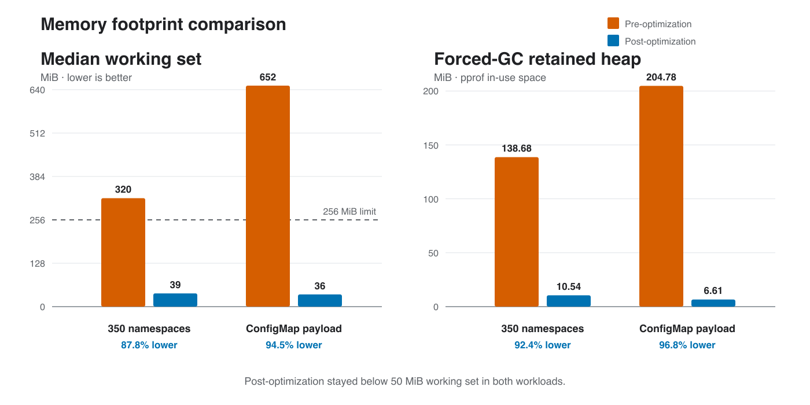
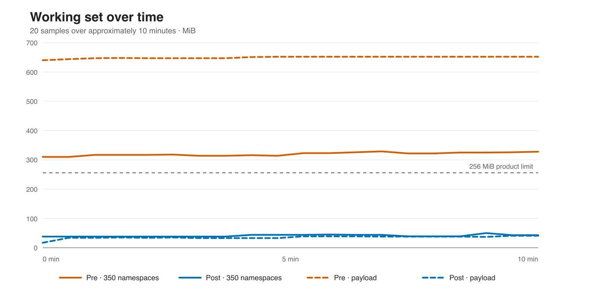

# Dashboard cache optimization results

Date: 2026-11-19
Issues: RHOAIENG-98546 / RHOAIENG-96488

## Summary

The optimized operator passed both workloads at the 256 MiB limit with zero restarts. The pre-optimization operator OOM-killed in both.

| Workload | Pre working set | Post working set | Reduction | Result at 256 MiB |
|---|---:|---:|---:|---|
| 350 namespaces / 3,500 objects | 320 MiB | 39 MiB | **87.8%** | Pre OOM in 18 s; post passed |
| 90 namespaces / 140.65 MiB payload | 652 MiB | 36 MiB | **94.5%** | Pre OOM in 27 s; post passed |

## 350-namespace workload

Fixture: 350 namespaces, 3,500 objects, 350 zero-replica Deployments.

| Median metric | Pre | Post | Reduction |
|---|---:|---:|---:|
| Container working set | 320 MiB | 39 MiB | **87.8%** |
| Process RSS | 340.26 MiB | 57.53 MiB | **83.1%** |
| Go heap allocated | 193.16 MiB | 10.41 MiB | **94.6%** |
| Go heap in use | 207.75 MiB | 15.30 MiB | **92.6%** |
| Go heap objects | 942,383 | 85,436 | **90.9%** |
| Forced-GC retained heap | 138.68 MiB | 10.54 MiB | **92.4%** |
| Forced-GC retained objects | 369,470 | 69,343 | **81.2%** |

Post maximum working set: **50 MiB**, leaving **206 MiB** below the limit. CPU time fell 106.91 → 1.37 seconds; reconciles fell 352 → 2.

## ConfigMap-payload workload

Fixture: 90 namespaces, 990 objects, 180 ConfigMaps containing 140.65 MiB.

| Median metric | Pre | Post | Reduction |
|---|---:|---:|---:|
| Container working set | 652 MiB | 36 MiB | **94.5%** |
| Process RSS | 492.26 MiB | 53.29 MiB | **89.2%** |
| Go heap allocated | 313.34 MiB | 10.20 MiB | **96.7%** |
| Go heap in use | 333.46 MiB | 15.49 MiB | **95.4%** |
| Go heap objects | 1,159,464 | 73,285 | **93.7%** |
| Forced-GC retained heap | 204.78 MiB | 6.61 MiB | **96.8%** |
| Forced-GC retained objects | 249,422 | 28,955 | **88.4%** |

Post maximum working set: **41 MiB**, leaving **215 MiB** below the limit. Average CPU fell approximately 98.7%; reconciles fell 364 → 2.

## Retained-type analysis

| Allocation path / GVK | Namespace pre | Payload pre | Post |
|---|---:|---:|---|
| `ConfigMap.Unmarshal` | 79.74 MiB flat | 171.17 MiB flat | Not sampled |
| `Secret.Unmarshal` | 16.17 MiB flat | 6.11 MiB flat | Not sampled |
| `Deployment.Unmarshal` | 7.50 MiB cumulative | 2.00 MiB cumulative | Not sampled |
| `ServiceAccount.Unmarshal` | 3.50 MiB cumulative | 10,923 cumulative objects | Not sampled |
| `RoleBinding.Unmarshal` | 3.50 MiB cumulative | 1.50 MiB cumulative | Namespace: not sampled; payload: 0 flat / 0.50 MiB cumulative |

The optimized profiles no longer retain the full workload objects that dominate the pre profiles. Remaining allocations are mainly REST mapping, discovery, metadata, runtime scheme, transport, and metrics overhead.

`pprof` attributes live allocations to allocation stacks; it is not an object-by-object deep-size census. “Not sampled” means no retained sample for that path after forced GC.

## Method

| Item | Value |
|---|---|
| Cluster | OpenShift 4.21.43; RHOAI 3.7.0-ea.1; 6 Ready nodes |
| Pre source | `466ab8c88cd769b3001660e569b52e1c7c1cc0f3` |
| Post source | `27efc6479a9cc1b503f7afa25905620933c338bc` |
| Aggregate sampling | 20 samples over approximately 10 minutes per image/workload |
| Pre profiling limit | 1 GiB after confirming OOM at 256 MiB |
| Post limit | 256 MiB |
| Diagnostic change | Loopback-only pprof on `127.0.0.1:6060`; no Service, Route, port, or RBAC |
| Validation | `make test` and `make lint` passed for both source revisions |

## Evidence

| Workload | Pre samples | Post samples | Pre profile | Post profile |
|---|---|---|---|---|
| 350 namespaces | [TSV](dashboard-cache-baseline-samples.tsv) | [TSV](dashboard-cache-post-optimization-samples.tsv) | [in-use space](dashboard-cache-namespace-pre-pprof-inuse-space.txt) | [in-use space](dashboard-cache-namespace-post-pprof-inuse-space.txt) |
| ConfigMap payload | [TSV](dashboard-cache-pre-optimization-payload-samples.tsv) | [TSV](dashboard-cache-post-optimization-payload-samples.tsv) | [in-use space](dashboard-cache-payload-pre-pprof-inuse-space.txt) | [in-use space](dashboard-cache-payload-post-pprof-inuse-space.txt) |

Raw heap, object, and allocation profiles remain beside this report.

## Status

- Profiling acceptance criterion: **complete for both reproducers**.
- Remaining ticket work: explicit envtest event-enqueue coverage and repository-integrated scale automation.
- Final verification: optimized diagnostic image at 256 MiB; Ready, zero restarts; Dashboard HTTP 200; all 6 nodes and 34 ClusterOperators healthy.

See [`dashboard-cache-test-plan.md`](dashboard-cache-test-plan.md) for the complete acceptance criteria.
